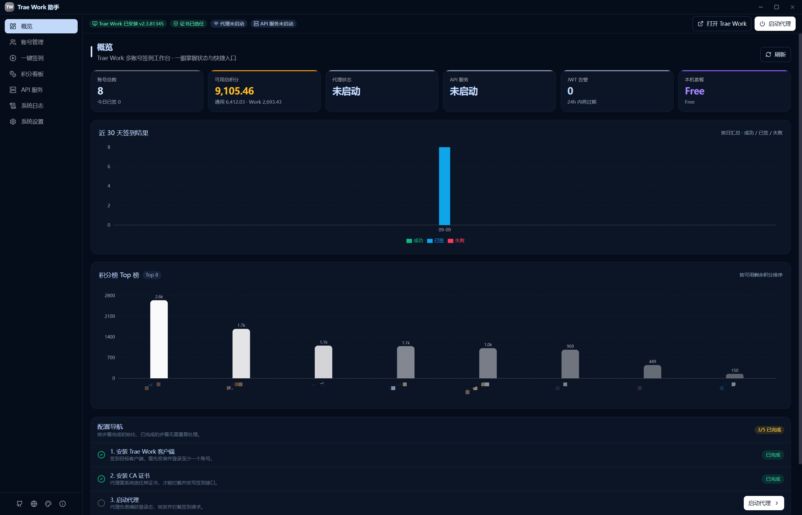
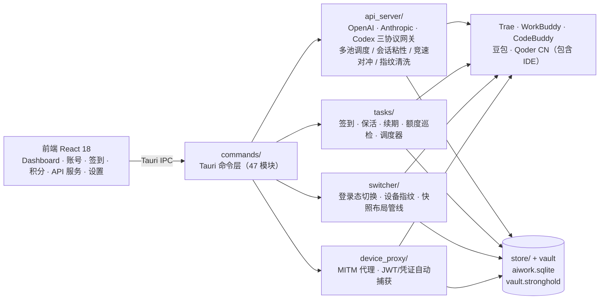

<div align="center">


# AI Work 助手（AI Work Assistant）

**Windows / macOS 桌面端 + Docker Web 版** 多账号签到与管理一站式工作台

     

**GitHub**：[github.com/smart-open](https://github.com/smart-open) · **个人博客**：[blog.sopenai.cn](https://blog.sopenai.cn/)

</div>

---

## 目录

- [产品形态与版本线](#产品形态与版本线)
- [支持的应用](#支持的应用)
- [核心功能](#核心功能)
- [系统架构](#系统架构)
- [数据存储](#数据存储)
- [开发](#开发)
- [环境变量](#环境变量)
- [重要提示与免责声明](#重要提示与免责声明)
- [文档](#文档)



> 深度支持 **Trae（Trae CN）/ WorkBuddy / CodeBuddy / 豆包 / Qoder CN（包含 IDE）** 五应用：多账号签到、登录态切换、积分看板、成长中心自动化、OpenAI / Anthropic / Codex 三协议兼容 API 网关（Trae + WorkBuddy + Qoder + 自定义模型多池调度）、6 层设备标识重置等；WorkBuddy 与 CodeBuddy 共享账号体系，豆包支持快照切换 / 保活 / 额度巡检 / 对话备份，Qoder 支持 PAT / OAuth 设备流 / IDE 登录态扫描三通道入池、每日双活动签到与网关上游接入（当前仅 CN 区）。后续规划扩展更多 AI 应用。

## 产品形态与版本线

一个产品内核，三种交付形态；同一套账号池与调度内核，按平台裁剪交付面。

| 版本线 | 分支 | 版本 | 平台 | 安装形态 | 构建发布 |
| --- | --- | --- | --- | --- | --- |
| **Windows 主线**（默认分支） | `main` | 3.x（自 3.0.0 起） | Windows 10 / 11 | msi / nsis 安装包、便携版 zip | 随版本发版 |
| **macOS 产品分支** | `macos_main` | 与 Windows 主线持续合并对齐 | macOS | dmg（aarch64 / x64 / universal） | GitHub Actions `build-macos.yml`，push 时自动构建发布 |
| **Docker 简化分支** | `docker_main` | 独立版本线 1.x | 任意可运行 Docker 的主机 | `docker compose up` 一键部署 | 镜像随分支构建 |

### 能力矩阵

| 能力 | Windows | macOS | Docker |
| --- | :---: | :---: | :---: |
| 多应用签到 / 积分看板 / 定时保活 | ✅ | ✅ | ✅ |
| API 网关多池调度（OpenAI / Anthropic / Codex 三协议） | ✅ | ✅ | ✅ |
| 界面形态 | 桌面窗口 | 桌面窗口 | 浏览器 Web UI（管理 REST + 网关 + 调度 + UI 单进程 `aiwork-server`） |
| 登录态切换 / 设备标识重置 | ✅ | ✅ | ❌（桌面专属，裁剪） |
| MITM 本地代理抓包 | ✅ | ✅ | ❌（桌面专属，裁剪） |
| 豆包（快照切换 / 保活 / 对话备份） | ✅ | ✅ | ❌（桌面专属，裁剪） |
| 定时任务 | 应用内调度器 + Windows 计划任务双轨 | 应用内调度器 | 进程内置定时调度 |
| 账号录入 | OAuth / 扫码 / PAT / 抓包 / auth 文件扫描 | 同 Windows | OAuth 录入或桌面版导出导入 |

## 支持的应用

| 应用 | 状态 | 说明 |
| --- | --- | --- |
| Trae（Trae CN） | ✅ 已支持 | 多账号签到、登录态切换、积分看板、网关 Trae 账号池、6 层设备标识重置 |
| WorkBuddy | ✅ 已支持 | 签到 + 成长中心自动化（旅行/盲盒/任务领奖）、积分三件套、定时保活/续期、网关 WorkBuddy 池 |
| CodeBuddy | ✅ 已支持 | 与 WorkBuddy 共享账号体系，auth 文件扫描入池、签到与登录态切换 |
| 豆包 | ✅ 已支持 | 签到、快照切换/保活/额度巡检/对话备份（公开 Open API 暂时搁置，见[重要提示](#重要提示与免责声明)） |
| Qoder CN（包含 IDE） | ✅ 已支持 | PAT / OAuth 设备流 / IDE 登录态扫描三通道入池、每日双活动签到、网关上游接入（当前仅 CN 区） |
| WorkBuddy AI / CodeBuddy AI（国际版） | ✅ 已支持 | 国际版客户端 authfile 布局变体，独立账号池 |
| 智谱清言 | 🕒 暂不支持 | 暂未规划。该平台每日登录可领积分，网页接口即可操作，未来或优先纳入 |
| MiniMax Code | 🕒 暂不支持 | 暂未规划。该平台每日签到领 400 积分（第 4/7 天更多），网页登录态可复用 |
| ModelScope 魔搭 | 🕒 暂不支持 | 暂未规划。该平台每日额度登录即发放，无签到端点，只适合做自动保活 + 额度巡检 |
| 讯飞 Loomy | 🕒 暂不支持 | 暂未规划。该平台有积分体系，支持短信直登 |
| ZCode / 智谱 GLM | 🕒 暂不支持 | 暂未规划。该平台额度经活动领取 |
| 通义万相 | 🕒 暂不支持 | 暂未规划。该平台接口存活，登录态复用情况待确认 |
| 腾讯元宝 | ❌ 暂不支持 | 签到仅在手机 App，桌面端无法实现 |
| Kimi / 文心一言 / 通义千问 | ❌ 暂不支持 | 无每日签到机制 |
| 妙手 CatPaw | ❌ 暂不支持 | 按套餐发放额度，无签到机制 |

> 更多平台扩展需求欢迎在 [issues](https://github.com/smart-open/TraeWorkAssistant/issues) 中反馈。

## 核心功能

- **账号管理**：多账号录入/编辑/OAuth 登录（含 WorkBuddy 扫码、Qoder OAuth 设备流 / PAT 导入）、分组管理、设备 ID 隔离、**本机 Trae 账号自动发现**、WorkBuddy/CodeBuddy auth 文件扫描入池、豆包抓包凭证回写、Qoder IDE 登录态扫描入池
- **登录态切换**：按目标应用独立切换——保存当前登录态 → 恢复目标账号 → 启动；Trae 系精准备份核心文件，豆包 chromium 布局含快照版本校验 + 单代回滚 + 防误覆盖守卫，WorkBuddy/CodeBuddy authfile 布局，Qoder 快照恢复自动注入账号绑定设备指纹；支持「一键以账号打开」
- **一键签到**：批量签到、按分组/手动勾选、跳过已签/过期、实时进度；WorkBuddy 成长中心自动化（旅行/盲盒/任务领奖）；Qoder 每日双活动（签到 + 登录奖励）与档期月历；豆包/WorkBuddy 定时保活与续期
- **积分看板**：Trae / Buddy / Qoder 三平台统一看板（KPI / 趋势 / 日热度 / 到期日历互不混装）；排行、三线趋势图、今日新增统计；WorkBuddy 积分三件套 + 官方用量 + 本地 Token 统计（缓存命中率/热力图）；Qoder 积分包逐包明细
- **本地代理**：MITM 代理自动捕获 JWT / 豆包凭证、注入独立设备 ID；**自动串联已有系统代理（VPN）作为上游**，停止时原样还原系统代理
- **API 网关**：内嵌 OpenAI / Anthropic / Codex Responses 三协议兼容 API 服务——Trae 账号池 + WorkBuddy 池 + Qoder 池 + 自定义 OpenAI 兼容模型多池调度（smart 智能策略/优先级/模型级覆盖、每池独立开关与调度参数）、会话粘性、慢请求竞速对冲、指纹清洗、`ck_` 子 Key、四段模型路由、生图双端点、web_search 工具代执行
- **定时任务**：Windows 计划任务 + 应用内调度器双轨，后台自动签到 / 保活 / 续期 / 额度巡检 / 模型目录同步
- **6 层设备标识重置**：machineid / storage.json 遥测 / aha.device / 注册表 MachineGuid / webview 追踪数据 / aha TinyStorage
- **快照管理**：查看/备份/恢复/删除账号登录态快照（各应用独立管理）；豆包/WorkBuddy 对话数据独立备份恢复与导出；Qoder / Trae 账号池加密导入导出
- **暗色模式**：6 套主题，图表动态适配
- **数据全部本地存储**，不上传任何服务器

## 系统架构

### 技术栈

| 层 | 选型 |
| --- | --- |
| 桌面壳 | Tauri 2（Windows：msi/nsis；macOS：dmg） |
| 前端 | React 18 + TypeScript 5 + Vite 5 + Tailwind 3 + Zustand 4 + Recharts 2 |
| 后端 | Rust（Tauri 命令层 + 内嵌 HTTP 服务），SQLite（WAL）+ Stronghold 加密保险库 |
| 网络 | ureq HTTP 客户端 + 内嵌 MITM 代理（自签 CA）+ tokio 流式管道 |
| Docker 版 | 单进程 `aiwork-server`（Rust axum 管理 REST + 网关 + 调度 + 静态 Web UI） |

### 架构分层



### 关键子系统

| 模块 | 职责 |
| --- | --- |
| `api_server/` | 三协议兼容 API 网关：多池调度（smart / 优先级 / 模型级覆盖）、会话粘性、慢请求首字节竞速对冲、请求指纹清洗、`ck_` 子 Key、用量统计 |
| `tasks/` | 签到与保活任务族（Trae / WorkBuddy / 豆包 / Qoder）、错误分类冷却状态机、账号池调度（`expire_first` / `credit_first` / `random`）、应用内调度器 |
| `switcher/` | 登录态切换器：按应用档案表驱动 icube / chromium / authfile / electron_root 四类布局管线，Qoder 设备指纹覆写 |
| `device_proxy/` | MITM 代理：捕获登录态与凭证回写账号库、注入独立设备 ID、串联系统代理（VPN） |
| `store/` | SQLite 持久化（kv 文档表 + 行文档实体表 + 列化流水表三形态，schema 版本化迁移） |
| `vault.rs` | Stronghold 加密保险库存凭证（Windows DPAPI 保护主密码），解密仅在内存完成 |

> 完整命令契约、协议参考与数据模型见 [技术架构设计](docs/tech-framework.md)。

## 数据存储

**所有数据 100% 本地存储，不上传任何服务器。**

```
%APPDATA%\AIWorkAssistant\
├── conf/
│   ├── app_settings.json        # 设置
│   ├── vault.stronghold         # 凭证加密保险库（DPAPI 保护主密码）
│   └── vault_key.bin
├── data/
│   ├── aiwork.sqlite            # 全量状态库（WAL）
│   │                            #   账号 / 分组 / 积分 / 设备映射 / 签到结果 /
│   │                            #   API 池与 Key / 模型目录 / 用量统计 /
│   │                            #   WorkBuddy / 豆包 / Qoder 状态
│   ├── backup/                  # 首次升级时旧版 JSON 数据自动迁入 SQLite 后的备份
│   ├── certs/                   # MITM 自签 CA 证书
│   ├── profiles*/               # 各应用登录态快照（按账号 ID 分目录 + .bak 单代回滚）
│   └── exports/                 # 对话记录等导出产物
└── logs/                        # proxy / checkin / switcher / api 日志
```

**存储原则**

- **单一状态库**：v3.4.5 起全部状态 JSON 迁入 `data/aiwork.sqlite`（WAL 模式；kv 键值文档表 + 行文档实体表 + 列化流水表三形态，`SCHEMA_VERSION` 幂等迁移，`store/schema.rs` 为权威定义）。
- **凭证零明文**：账号凭证统一入 Stronghold 加密保险库，主密码由操作系统级保护（Windows DPAPI）；解密仅在内存完成，无临时文件。
- **登录态快照隔离**：各应用快照按账号 ID 分目录管理，含版本校验与 `.bak` 单代回滚，防误覆盖。
- **平滑升级**：旧版 JSON 数据首启自动导入 SQLite 并移入 `data/backup/`，无需手动迁移。

> macOS / Docker 版数据目录布局随各自分支文档为准，结构同源。

## 开发

前置：Node.js 18+、Rust 1.85+（`Cargo.toml` rust-version）、WebView2 Runtime、VS Build Tools (C++)

```powershell
npm install
npm run tauri dev      # 开发模式
npm run tauri build    # 打包（msi + nsis）
node scripts/rename_release.mjs     # 安装包统一输出到 release/，命名 AI Work 助手_<版本>_x64*
node scripts/package_portable.mjs   # 便携版 zip（AI Work 助手_<版本>_x64_portable.zip）
```

测试：`cargo test`（Rust 单测）、`npm run test`（vitest 前端）、`npx tsc --noEmit`（类型检查）

## 环境变量

| 变量 | 默认 | 说明 |
| --- | --- | --- |
| `AIWORK_MAX_BODY_BYTES` | `33554432`（32MiB） | API 网关请求体上限（单位：字节），合法区间 256KiB~64MiB，非法 / 越界值回退默认并在日志告警。agent CLI 等长上下文客户端若仍报 413 `request_too_large`，可调高至 64MiB 内的任意值 |

修改后需重启应用生效（进程启动时解析一次）。

## 重要提示与免责声明

### 📌 各自资源请使用各自的客户端

> **Trae 的资源用 Trae 客户端**、**WorkBuddy / CodeBuddy 的资源用 WorkBuddy / CodeBuddy 客户端**、**Qoder 的资源用 Qoder 客户端**、**豆包的资源用豆包客户端**。
>
> 各应用的登录态、权益与额度同官方客户端强绑定，请勿跨客户端混用资源（如用 A 客户端消费 B 应用的额度）——上游风控识别到客户端与资源不匹配时，会以空响应 / 指纹拦截乃至账号封禁处置，风险自担。

### 🚨 豆包公开 Open API 暂时搁置

> **豆包「公开 Open API」相关功能暂时搁置，恢复时间待定。**
>
> 目前豆包官方风控较为严格，作者本人多个账号已被封禁。为避免更多用户遭受账号损失，该方向的功能暂停推进，请知悉并谨慎评估相关使用风险。

### 免责声明

> 本工具仅供学习研究和个人使用，使用者需自行承担一切风险与后果。

1. **非官方申明**：本工具与 Trae 等相关产品官方**无任何隶属、合作或关联关系**，系个人开源项目，不代表官方立场。
2. **使用风险**：使用本工具可能违反 Trae 的服务条款；由此产生的任何后果（包括但不限于账号封禁、积分清零/扣除、功能限制、数据异常等）均由使用者自行承担。
3. **责任范围**：本工具不对因使用（或无法使用）本工具所导致的任何直接、间接、附带或后果性损失负责。
4. **合规义务**：使用前请务必仔细阅读 Trae 的服务条款，并自行判断是否使用；请确保仅用于管理本人合法持有的账号，遵守所在地法律法规。
5. **作者免责**：本工具作者对任何因使用、误用或滥用本工具而引发的纠纷、争议或问题不承担任何责任。
6. **侵权处理**：若您是相关官方且认为本工具侵犯了您的合法权益，请通过项目渠道联系作者，我们将在核实后及时下架处理。

**使用本工具即表示你已阅读、理解并同意上述全部免责声明。**

## 文档

- [更新日志](CHANGELOG.md) — 各版本变更记录
- [用户手册](docs/user-manual.md) — 功能说明与使用指南
- [产品设计](docs/product-design.md) — 需求与产品设计基线（v1.0/v2.0）
- [产品优化需求清单](docs/backlog.md) — 全项目唯一待办依据（需求概述/实现路径/参考开源项目）
- [技术架构设计](docs/tech-framework.md) — 架构/数据模型/协议参考（含 WorkBuddy、豆包协议附录与开源仓库映射）/开发运维

## 赞赏

如果这个项目对你有帮助，欢迎请作者喝杯快乐水 ☕

<div align="center">

</div>

## License

本项目采用 [MIT License](LICENSE)，版权归 **朱天伟**（Copyright © 2026 朱天伟）所有。

Fork / 二次开发请保留 `LICENSE` 及版权声明；引用或借鉴请注明原作者及原始仓库 `https://github.com/smart-open/TraeWorkAssistant`，派生项目须说明以原库为基础，原库版权与出处不变。
